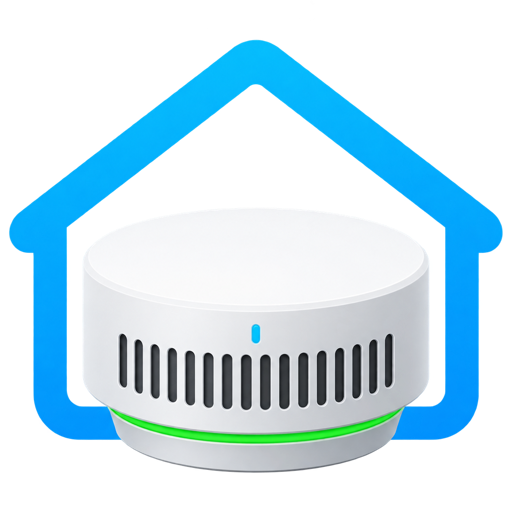

# UniFi Protect Air Quality for Home Assistant

<p align="center">
  
</p>

Bring your **UniFi Protect UP-AirQuality** sensors into Home Assistant.
See temperature, humidity, carbon dioxide and air-quality readings, use alarms
in automations, and adjust supported sensor settings from the device page.

The integration connects directly to your Protect console over your local
network. It does not need MQTT or an additional bridge.

## Contents

- [Before you start](#before-you-start)
- [Prepare the Protect account](#prepare-the-protect-account)
- [Install the integration](#install-the-integration)
- [Connect Home Assistant to Protect](#connect-home-assistant-to-protect)
- [Find your readings and configure the sensors](#find-your-readings-and-configure-the-sensors)
- [Change the connection or password](#change-the-connection-or-password)
- [Update or restore an installation](#update-or-restore-an-installation)
- [Troubleshooting](#troubleshooting)
- [Remove a sensor or the integration](#remove-a-sensor-or-the-integration)

## Before you start

You need:

- **Home Assistant 2026.10.4 or newer**, with an administrator account.
- A UniFi console running **Protect**, with at least one **UP-AirQuality**
  sensor already adopted and showing readings in Protect.
- The console's local hostname or IP address and its HTTPS port, normally
  **443**. Home Assistant must be able to reach that address.
- A dedicated **local UniFi OS account** with access to Protect and the sensors.
- A Home Assistant backup before installing or updating the integration.

This integration is for **UP-AirQuality**. Configure the console's address,
not the sensor's address. You add the integration once per console; its
UP-AirQuality devices are then added automatically.

## Prepare the Protect account

1. Open your UniFi console's **local web interface** and sign in as an
   administrator.
2. Open **Admins & Users**, select **Admins**, and add a dedicated account,
   for example `homeassistant`. Menu names can vary with UniFi OS.
3. Select **Restrict to local access only** and set a local username and password.
4. Give the account Protect access and access to the UP-AirQuality devices:
   reading measurements needs read access; changing LEDs, night mode or alarm
   thresholds also needs permission to change sensor settings.
5. Sign in locally with this account and check that it can see the sensor
   readings. Keep its username and password for the Home Assistant setup.

The [local-account instructions in Home Assistant's Protect documentation](https://www.home-assistant.io/integrations/unifiprotect/#add-a-local-user)
show the UniFi account screens. **This integration asks for the local username
and password; it has no API-key field.** A Ubiquiti cloud-only login cannot be
used in that form.

## Install the integration

For a **supported installation**, use the fixed ZIP in Option 1 and keep its
original filename. It identifies the exact package for recovery and support.

### Option 1: Download and copy the integration

Use this option for a fixed installation package. HACS and a GitHub account
are not required.

First, make sure you can copy folders into Home Assistant:

- **Home Assistant OS:** Use your existing file-management app or set up
  [Samba share](https://www.home-assistant.io/common-tasks/os/#installing-and-using-the-samba-share-app).
  Open its `config` share from your computer to copy the integration folder.
- **Home Assistant Container:** Open the host folder mounted at `/config`
  using your host's file manager. Home Assistant apps are not available with
  Container.

1. **[Download the installation ZIP](https://github.com/Daniel-Dietz/ha-unifi-air-quality/archive/648aeaada3468b981d183a1ef206e411b00de50b.zip)** and extract it.
   Keep the ZIP with its original filename alongside your backup.
2. Open your **Home Assistant configuration directory**, the folder containing
   `configuration.yaml`. On Home Assistant OS this is normally `/config`.
   With Home Assistant Container, use the host folder mounted at `/config`.
   If unsure, check **Settings → System → Repairs → ⋮ → System information →
   Configuration directory**.
3. Create a folder named `custom_components` there if it does not already exist.
4. In the extracted ZIP, open `custom_components`. Copy its entire
   **`unifi_air_quality` folder**, including all subfolders, into Home Assistant's
   `custom_components` folder.
5. Check that the resulting file is:

   ```text
   /config/custom_components/unifi_air_quality/manifest.json
   ```

   The ZIP's outer `ha-unifi-air-quality-…` folder must not sit between
   `custom_components` and `unifi_air_quality`.
6. Restart Home Assistant: **Settings → System → power menu → Restart
   Home Assistant → Restart**.
7. Continue with [Connect Home Assistant to Protect](#connect-home-assistant-to-protect).

See the official
[configuration-directory guide](https://www.home-assistant.io/docs/configuration/)
if you need help locating that folder.

### Option 2: Home Assistant Marketplace

On **Home Assistant 2026.11 or newer**, use the built-in Marketplace if you
prefer to manage downloads and updates in the Home Assistant interface.

1. Open **Settings → Marketplace**.
2. Select **Add from link** and enter:

   ```text
   https://github.com/Daniel-Dietz/ha-unifi-air-quality
   ```

3. Connect GitHub when prompted, then select **Add**. If asked for a content
   type, choose **Integration**.
4. Open **UniFi Protect Air Quality**, select **Install**, and confirm.
5. Follow the setup prompt. If Home Assistant requests a restart, complete it
   first. You can also start setup manually as described below.

See the official [Marketplace guide](https://www.home-assistant.io/integrations/marketplace/#custom-repositories)
for the GitHub connection and download controls.

### Option 3: HACS

On **Home Assistant 2026.10.4–2026.10.x**, you can use HACS if it is already
installed.

1. Open **HACS**.
2. Select **⋮ → Custom repositories**.
3. Enter `https://github.com/Daniel-Dietz/ha-unifi-air-quality`, select
   **Integration** as the type, and select **Add**.
4. Find and open **UniFi Protect Air Quality** from **Daniel-Dietz**.
5. Select **Download** and confirm.
6. Restart Home Assistant and continue with the connection setup below.

See [HACS custom repositories](https://www.hacs.xyz/docs/faq/custom_repositories/)
if the repository is not listed.

**Choose one installation method for this integration.** The fixed ZIP is covered
by the [supported installation policy](docs/install-upgrade-rollback.md#supported-distribution-and-identity).
Marketplace and HACS download moving repository contents; those unpinned
packages are outside that support policy. These are optional download methods
for users who choose to manage that limitation. Avoid having a package manager
overwrite a manually maintained copy.

## Connect Home Assistant to Protect

1. Open **Settings → Devices & services**.
2. Select **Add integration**.
3. Search for **UniFi Protect Air Quality** and select that exact name.
4. Fill in the connection form:

| Field | What to enter |
| --- | --- |
| **Host** | The Protect console's hostname, such as `protect.example.net`, or its local IP address. Enter only the hostname or IP: no `https://`, port or `/protect` path. |
| **Port** | `443`, unless your console uses a different HTTPS port. |
| **Local username** | The dedicated local account created above. |
| **Password** | That account's local password. |
| **Verify TLS certificate** | Leave enabled when Home Assistant trusts the console's certificate and the hostname matches it. |

5. Submit the form. Home Assistant checks the connection and creates the
   integration entry.
6. Open the entry and its device list. Select your UP-AirQuality sensor and
   compare its first readings with Protect. Allow about one minute for a refresh.
7. Assign the device to a room and add the measurements you want to your
   dashboard using Home Assistant's normal dashboard editor.

Everything is configured through the interface. No `configuration.yaml`
entries are needed.

### Certificate errors during setup

Home Assistant must trust the certificate presented by the console, and the
host you enter must match that certificate. For a private certificate authority,
trust must be configured in the Home Assistant runtime; accepting a browser
warning does not do that.

If your console has a self-signed certificate, the form allows you to turn off
**Verify TLS certificate**. This disables verification of the console's identity
and allows an attacker on the network to intercept credentials and readings.
Prefer a trusted certificate. You can change this choice later with
**Reconfigure**.

## Find your readings and configure the sensors

Open **Settings → Devices & services → UniFi Protect Air Quality**, then select
a device. Home Assistant shows the device's measurements, alarm states and
configuration controls there. Names follow your Home Assistant language.

### Measurements

| Measurement | Displayed unit |
| --- | --- |
| Air quality index | AQI, without a physical unit |
| Carbon dioxide | ppm |
| Temperature | °C, converted by Home Assistant where applicable |
| Humidity | % |
| PM1, PM2.5, PM4 and PM10 | µg/m³ |
| Total volatile organic compounds (TVOC) | Protect value, without a declared unit |
| VOC index, NOx index and vape index | No physical unit |

**NOx is disabled by default.** To use it, open the device's entity list, show
disabled entities, select the NOx entities you need, and enable them in their
settings. The firmware must also supply a reading. Enabling an entity cannot
create a value that the device does not provide.

Readings normally arrive automatically. A refresh also runs about once a minute.
When a reading has not been confirmed for roughly two minutes, it becomes
unavailable instead of presenting old data as current. Readings return
automatically after the connection and data recover.

### Device settings

The device's **Configuration** section contains these controls, where the
console supplies the setting:

| Setting | What you can change |
| --- | --- |
| Status light and activity feedback | On or off |
| LED ring | On/off, brightness, and whether it displays CO₂ or air quality |
| Night mode | On/off, brightness, start time and end time |
| Vape detection | On/off and sensitivity |
| Measurement alarms | Enable state and lower/upper thresholds; vape has only an editable upper threshold |

Changes are sent to Protect and affect the physical sensor. They require write
permission on the local account. Home Assistant displays the value confirmed by
Protect. If a change is not confirmed immediately, wait for the next refresh and
check the setting in Protect before trying again.

### Alarm thresholds and automations

A measurement's **Alarm** entity reports its current alarm state. Its **Alerts**
switch and threshold controls configure the alarm.

In Home Assistant's device view, the alarm symbols show the current state:

- **OK:** a green check mark in a circle.
- **Alarm active:** a red exclamation mark in a circle.
- **Unknown:** a question mark in a circle.
- **Unavailable:** Home Assistant's normal unavailable-state presentation.

The green check returns when current data confirms OK.

- Set at least one lower or upper threshold to enable a measurement alarm.
- Turning a measurement alarm off clears its thresholds. Enter a threshold again
  to enable it.
- Vape behaves differently: disabling its alarm retains the device-managed
  thresholds. Changing vape sensitivity also changes the upper vape threshold.
- An unset threshold is displayed as `0` in the number control. Check the
  **Alerts** switch to distinguish an unset threshold from an enabled alarm.
- An unknown or unavailable alarm state does **not** mean that the alarm cleared.

For a simple notification, create an automation under **Settings → Automations
& scenes**. Use a state trigger for the relevant alarm binary sensor, set **To**
to `on`, leave **From** empty, and choose your notification action. This also
captures a first alarm after an unknown or unavailable state. An alarm that is
still active when the connection recovers can therefore trigger a notification.

For event-based automations, the device also has an **Air quality alarm event**
entity. Example event types are `co2_alarm_started`, `co2_alarm_ended`,
`vape_alarm_started` and `vape_alarm_ended`.

## Change the connection or password

**Address, port or certificate:** Open the existing integration entry's
**⋮ → Reconfigure** action. Enter the changed host, port or TLS setting and
submit. It must still be the same Protect console. Existing device names,
entity IDs and automations remain associated with the entry.

**Changed password:** When Home Assistant asks you to reauthenticate, enter the
new password for the same local username. This prompt updates the password;
it does not change the username. Keep the existing integration entry.

**Another console:** Add a separate **UniFi Protect Air Quality** integration
entry for that console.

## Update or restore an installation

### Update

1. Create a Home Assistant backup under **Settings → System → Backups**.
   Keep a copy outside the Home Assistant device and save its encryption key
   if the backup is encrypted.
2. Update through the installation method you already use:
   - **Marketplace:** Install the offered update under **Settings → Updates**.
   - **HACS:** Open this repository in HACS and install its offered update.
     **Redownload** reinstalls the currently available package.
   - **Manual:** Download the ZIP linked in the repository's
     [current README](https://github.com/Daniel-Dietz/ha-unifi-air-quality#readme)
     and extract it outside the active component folder. Under **Settings →
     Devices & services**, disable **every** UniFi Protect Air Quality console
     entry using **⋮ → Disable**. If Home Assistant requests a restart, complete
     it before changing any files; resolve any disabling error before continuing.
     Save the previous `unifi_air_quality` folder
     outside `custom_components`, then replace the complete folder with the one
     from the new ZIP. Finish copying before continuing.
3. Restart Home Assistant to load the updated files.
4. For a manual update, enable the same console entries again with **⋮ → Enable**.
5. Open the existing devices and check their readings and your automations.

**Keep the integration entry when updating.** Deleting it is not an update
step. In Marketplace, **Delete and uninstall** also removes the integration's
devices and entities, so use the update action instead.

### Restore after a problem

Restore the Home Assistant backup made before the change from
**Settings → System → Backups**. Keep your original installation ZIP or package
backup until you have confirmed the update works. If Home Assistant itself no
longer opens, follow the official
[backup recovery instructions](https://www.home-assistant.io/common-tasks/general/backups/#restoring-a-backup).

## Troubleshooting

| Problem | What to check |
| --- | --- |
| **Integration does not appear under Add integration** | Confirm that `custom_components/unifi_air_quality/manifest.json` exists, perform a full Home Assistant restart, then refresh the browser. Check the minimum HA version and logs if it is still missing. |
| **Cannot connect** | Use the console's address, not the sensor's. Check the separate HTTPS port, DNS and firewall access from Home Assistant to the console. |
| **Invalid username or password** | Verify the dedicated account can sign in to the console locally and has Protect access. Use its local credentials. If its password changed, complete the reauthentication prompt. |
| **TLS/certificate error** | Check that the host matches the certificate and that Home Assistant trusts its issuer. See [certificate errors](#certificate-errors-during-setup). |
| **Setup succeeds but no devices appear** | Confirm the UP-AirQuality is adopted in this console and visible to the configured account. Allow a refresh to complete. |
| **Measurements are unavailable** | Check the sensor is online in Protect and that Protect supplies that reading. Restore connectivity and wait for a refresh. |
| **OK still shows a grey check mark** | Update the integration, restart Home Assistant and refresh the page. The green check is supplied for a confirmed, available OK state. Custom dashboard cards may override or ignore entity pictures; Home Assistant's device view displays them. |
| **NOx is missing or has no value** | Enable the relevant NOx entities. Some firmware does not provide a numeric NOx reading. |
| **Measurements work but controls fail** | Give the local account permission to change the sensor's settings in Protect. Read access alone is insufficient for controls. |
| **An alarm cannot be enabled** | Set a lower or upper threshold first. |
| **A changed setting returns to its previous value** | Check the confirmed setting in Protect and wait for the next refresh. The device may reject or adjust that value. |
| **Reconfigure says the address belongs to another console** | Reconfigure only accepts the existing console. Add a separate entry for a different one. |
| **Unsupported response after a Protect update** | Check for an integration update. If it continues, report the Home Assistant, Protect and sensor firmware versions with reviewed diagnostics. |

For more details, open **Settings → System → Logs** and look for
`unifi_air_quality`. You can download diagnostics from the integration entry's
**⋮ → Download diagnostics** menu.

If you need help, [open an issue](https://github.com/Daniel-Dietz/ha-unifi-air-quality/issues).
Include the installation ZIP filename or installed version, Home Assistant and
Protect versions, what you expected, and what happened. Review logs and
diagnostics before attaching them: measurements and settings can still describe
your home. Never include passwords, tokens or raw unreviewed Protect responses.

## Remove a sensor or the integration

**One sensor:** Remove/unpair it in Protect first. Then open its device page in
Home Assistant and use **Delete**. Protect must be reachable so the integration
can confirm removal. A sensor that is temporarily offline should remain in Home
Assistant; its existing entities recover when it returns.

**One console:** Delete only that console's integration entry under
**Settings → Devices & services**. Keep the integration files while any other
console still uses them.

**The whole integration:** Remove all its console entries, then uninstall its
files through Marketplace/HACS, or remove
`custom_components/unifi_air_quality` for a manual installation. Restart Home
Assistant. This permanently removes the integration setup.

## License

[MIT](LICENSE). UniFi and UniFi Protect are trademarks of Ubiquiti Inc.
This project is not affiliated with Ubiquiti.
